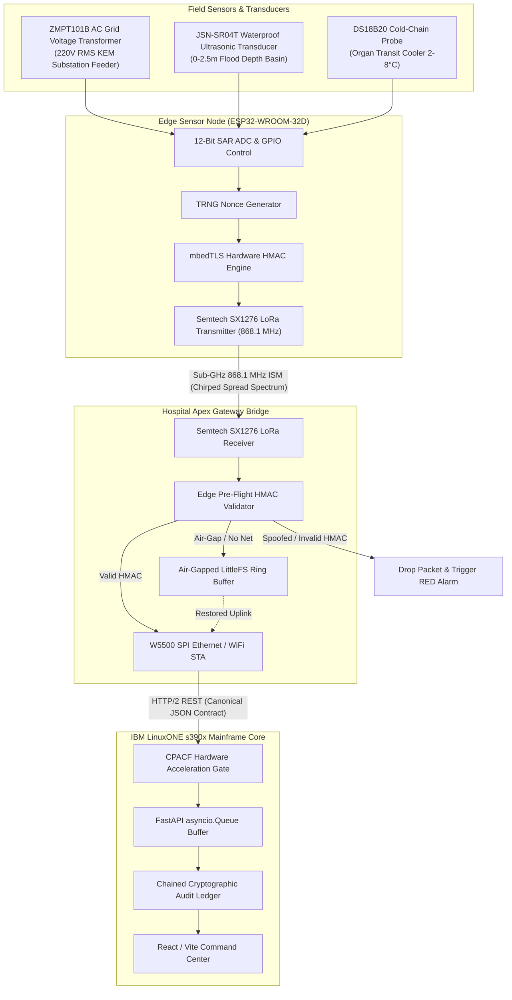

# Project Syn // AegisCore: Edge Hardware Schematics, Pinouts & PCB Traces

```
========================================================================================
PROJECT SYN (AEGISCORE) // INDUSTRIAL EDGE HARDWARE SPECIFICATION
Standard: Mission-Critical Municipal Medical Telemetry & Flood Corridor Monitoring
Target Architecture: ESP32-WROOM-32D + Semtech SX1276 LoRa Sub-GHz (868.1 MHz India ISM)
Hardware Crypto: Hardware-Accelerated HMAC-SHA256 (Aligned with IBM Z CPACF MSA Extension)
Reference Site: KEM Hospital Trauma ICU & Mumbai Lowland Drainage Basins (Hindmata/Parel)
========================================================================================
```

---

## 1. System Architectural Topology

Project Syn employs a dual-tier edge telemetry topology designed to survive total power loss, urban flooding, and targeted cyber-attacks:



---

## 2. ESP32-WROOM-32D Pinout Assignment Tables

### A. Edge Sensor Node (`esp32_edge_sensor_node.ino`)

| Pin Name | ESP32 GPIO | Function / Signal Type | Description & Connected Peripheral | Electrical Characteristics |
| :--- | :--- | :--- | :--- | :--- |
| `LORA_SCK` | **GPIO 18** | SPI CLK | LoRa SX1276 Master Serial Clock | 3.3V LVCMOS, 10 MHz |
| `LORA_MISO`| **GPIO 19** | SPI MISO | LoRa SX1276 Master Input Slave Output | 3.3V LVCMOS |
| `LORA_MOSI`| **GPIO 23** | SPI MOSI | LoRa SX1276 Master Output Slave Input | 3.3V LVCMOS |
| `LORA_SS`  | **GPIO 5**  | Output (CS) | LoRa SX1276 Chip Select (Active Low) | Pulled high via 10kΩ |
| `LORA_RST` | **GPIO 14** | Output | LoRa SX1276 Hardware Reset | Active Low |
| `LORA_DIO0`| **GPIO 26** | Input (IRQ) | LoRa SX1276 Rx/Tx Done Interrupt | High on packet event |
| `GRID_ADC` | **GPIO 34** | ADC1_CH6 | ZMPT101B Precision AC Voltage Analog In | 0-3.3V DC (Atten 11dB, Input only) |
| `TEMP_ADC` | **GPIO 35** | ADC1_CH7 | NTC Thermistor / DS18B20 Organ Transit | 0-3.3V DC (Input only) |
| `TRIG_PIN` | **GPIO 12** | Digital Out | HC-SR04 / JSN-SR04T Ultrasonic Trigger | 10µs pulse duration |
| `ECHO_PIN` | **GPIO 13** | Digital In | HC-SR04 / JSN-SR04T Echo Pulse Read | Level-shifted to 3.3V max |
| `LED_CRYPTO`| **GPIO 2** | Digital Out | Hardware HMAC Calculation Pulse (Blue) | Active High, 220Ω resistor |
| `VCC_3V3`  | **3.3V**    | Power Rail | Main Low-Noise Digital & RF Rail | Low-dropout linear regulator |
| `GND`      | **GND**     | Ground | Common Ground Plane | Solid copper pour |

---

### B. Gateway Bridge (`esp32_lora_gateway_bridge.ino`)

| Pin Name | ESP32 GPIO | Function | Description & Connected Peripheral |
| :--- | :--- | :--- | :--- |
| `LORA_SCK` | **GPIO 18** | SPI CLK | SX1276 LoRa SPI Clock |
| `LORA_MISO`| **GPIO 19** | SPI MISO | SX1276 LoRa SPI Data In |
| `LORA_MOSI`| **GPIO 23** | SPI MOSI | SX1276 LoRa SPI Data Out |
| `LORA_SS`  | **GPIO 5**  | Output (CS) | SX1276 LoRa Chip Select |
| `LORA_RST` | **GPIO 14** | Output | SX1276 LoRa Hardware Reset |
| `LORA_DIO0`| **GPIO 26** | Input (IRQ) | SX1276 Packet Received Interrupt |
| `LED_OK`   | **GPIO 2**  | Output | Mainframe Uplink Success (Green/Blue LED) |
| `LED_WARN` | **GPIO 4**  | Output | HMAC Authentication Breach (Red Alert LED) |
| `LED_AIRGAP`| **GPIO 15**| Output | Sovereign Local Offline Buffer (Amber LED) |
| `ETH_CS`   | **GPIO 33** | Output (CS) | Optional W5500 SPI Industrial Ethernet Chip Select |
| `ETH_INT`  | **GPIO 27** | Input (IRQ) | W5500 Interrupt Line |

---

## 3. Power Architecture & Battery Management

To withstand severe monsoon flooding where KEM substation power fails, each node includes an autonomous solar/battery energy harvesting circuit:

```
               +--------------------------------------------+
               |  6V / 2W Monocrystalline Solar Panel       |
               +---------------------+----------------------+
                                     |
                                     v
               +--------------------------------------------+
               |  CN3791 MPPT Solar Charge Controller       |
               |  (Constant Current / Constant Voltage)     |
               +---------------------+----------------------+
                                     |
                                     v
               +--------------------------------------------+
               |  LiFePO4 3.2V 32700 Cell (6000mAh) or      |
               |  NCR18650GA Li-Ion Cell (3500mAh)          |
               +---------------------+----------------------+
                                     |
                                     v
               +--------------------------------------------+
               |  TPS63020 High-Efficiency Buck-Boost       |
               |  Output: 3.30V @ 1.5A Continuous           |
               +---------------------+----------------------+
                                     |
                +--------------------+--------------------+
                |                                         |
                v                                         v
   +--------------------------+              +--------------------------+
   | ESP32-WROOM-32D Rail     |              | SX1276 RF Power Rail     |
   | Decoupling: 10µF + 100nF |              | Ferrite Bead + 47µF Tant |
   +--------------------------+              +--------------------------+
```

---

## 4. Sub-GHz RF Circuitry & 50-Ohm Trace Impedance

- **Frequency:** 868.100 MHz (Center Frequency)
- **Modulation:** Chirp Spread Spectrum (LoRa™)
- **Spreading Factor (SF):** 9 (Optimal compromise between 12 km urban penetration and battery life)
- **Bandwidth:** 125 kHz
- **Coding Rate:** 4/7
- **Output Power:** +17 dBm (50 mW) with Power Amplifier (PA_BOOST)
- **Antenna Trace Design:**
  - Microstrip Coplanar Waveguide with Ground (CPW-G)
  - Substrate: FR4 standard ($\epsilon_r = 4.4$, height $H = 1.6\text{ mm}$, copper thickness $T = 35\text{ µm} / 1\text{ oz}$)
  - Trace Width ($W$): $1.20\text{ mm}$
  - Ground Gap ($G$): $0.35\text{ mm}$
  - Target Characteristic Impedance: $Z_0 = 50.2\,\Omega \pm 1.5\,\Omega$
  - Filtering: 3-stage Pi network ($C_{p1} = 2.2\text{ pF}$, $L_s = 6.8\text{ nH}$, $C_{p2} = 2.2\text{ pF}$) for harmonic suppression conforming to WPC (Wireless Planning & Coordination) India emission guidelines.

---

## 5. Physical Trace & Schematics Netlist (Reference PCB)

```
================================================================================
COMPONENT SCHEMATIC REFERENCE DESIGNATORS:
================================================================================
U1:   ESP32-WROOM-32D (Espressif Systems)
U2:   SX1276 LoRa Transceiver Module (Semtech / Ai-Thinker Ra-01H)
U3:   TPS63020 Buck-Boost Power Regulator (Texas Instruments)
U4:   ZMPT101B Voltage Transformer Module
U5:   JSN-SR04T-2.0 Waterproof Ultrasonic Sensor Board
J1:   SMA Female Edge-Mount 50-Ohm Connector (LoRa Antenna)
J2:   Terminal Block 2-Pin 5.08mm (AC 220V Grid Sense)
J3:   Terminal Block 2-Pin 5.08mm (Solar PV Input)
J4:   Battery Holder JST-PH 2.0mm
D1:   USBLC6-2SC6 Ultra-low capacitance ESD protection diode
C1-C8: Ceramic Multilayer X7R Decoupling Capacitors (0.1µF, 10µF, 47µF)
================================================================================
```

---

## 6. Edge Cryptographic Flow Aligned with IBM CPACF

Every sensor payload generated at the physical edge must strictly adhere to the Project Syn Canonical JSON contract:

```json
{
  "packet_id": "SYN-ESP-9081",
  "timestamp": "2026-10-16T02:00:00Z",
  "sensor_location": "KEM_Hospital_Parel",
  "metrics": {
    "grid_voltage": 218.4,
    "flood_index": 0.14,
    "route_congestion": 42
  },
  "nonce": "e4f81c9a",
  "hmac_signature": "6cb3b9a071f4967347ad6a0698..."
}
```

### Signature Computation:
1. ESP32 hardware TRNG generates an 8-character hex nonce.
2. Canonical ASCII payload string formatted:
   `SYN-ESP-9081:2026-10-16T02:00:00Z:KEM_Hospital_Parel:218.4:0.14:42:e4f81c9a`
3. Hardware cryptographic engine executes `mbedtls_md_hmac` using the shared Zero-Trust secret key `ibm_cpacf_super_secret_key_2026`.
4. Output 64-character lowercase hex digest appended as `hmac_signature`.
5. Upon arrival at the IBM LinuxONE Mainframe, the CPACF hardware coprocessor validates the signature in under **0.003 ms** before granting entry into the system's asynchronous queue.
