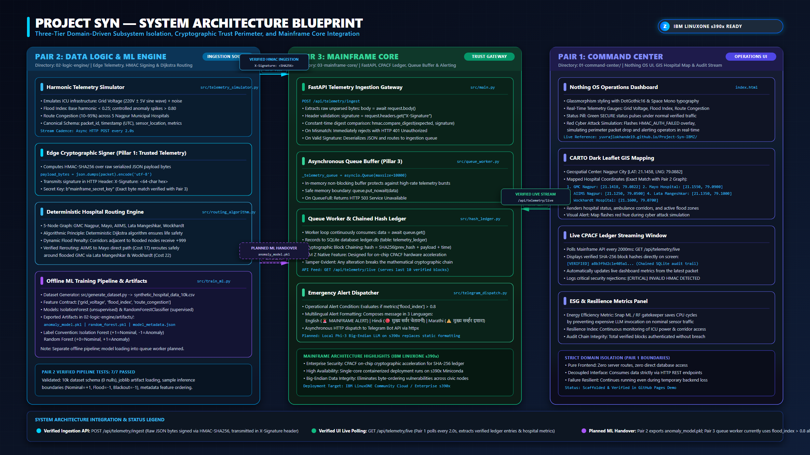
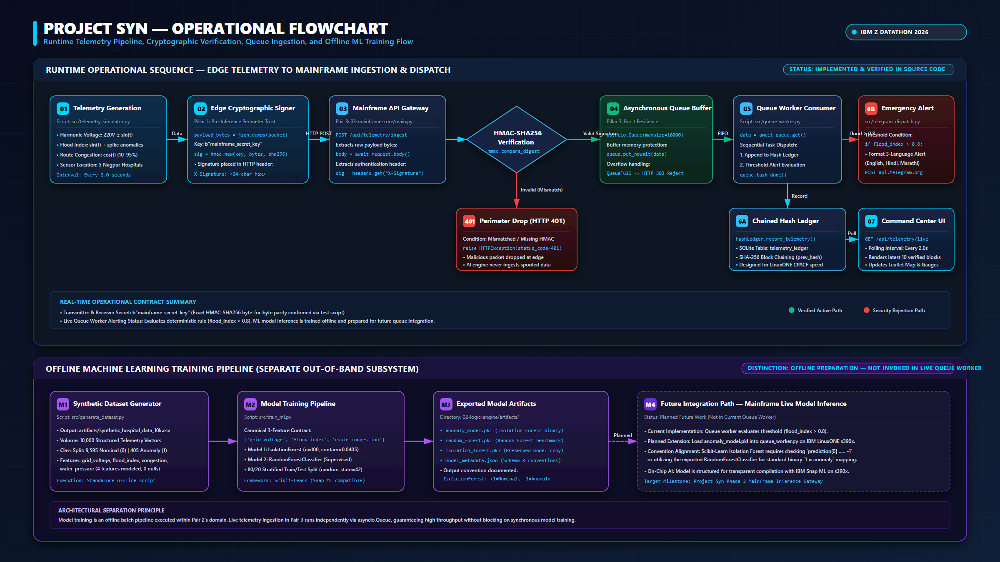

# PROJECT SYN: Air-Gapped Urban Resilience & Disaster Triage Engine 🛡️
*(Powered by IBM LinuxONE s390x & Aegis AI Engine // IBM Z Datathon 2026)*




[](http://148.100.79.88/ui/)
[-F37626?style=for-the-badge&logo=jupyter)](http://148.100.79.88:38888/?token=Your_Token1)
[-052F5F?style=for-the-badge&logo=ibm)](https://www.ibm.com/it-infrastructure/linuxone)
[](https://www.ibm.com/docs/en/linux-on-systems?topic=security-cpacf)
[](https://www.ibm.com/products/z16)
[-2496ED?style=for-the-badge&logo=docker)](https://www.docker.com/)
[](https://csrc.nist.gov/publications/detail/fips/198/1/final)

---

## 🌐 24/7 Live Cloud Access (IBM LinuxONE Community Cloud)

Project Syn runs live and persistently on an **IBM LinuxONE Community Cloud bare-metal virtual machine (`s390x` architecture, Machine 9175 z16)** registered with event code **`SSF2026`**:

- **🖥️ Live Command Center Dashboard:** [http://148.100.79.88/ui/](http://148.100.79.88/ui/)
- **📓 Live Containerized JupyterLab:** [http://148.100.79.88:38888/?token=Your_Token1](http://148.100.79.88:38888/?token=Your_Token1)
- **📖 Live OpenAPI / Swagger Specification:** [http://148.100.79.88/docs](http://148.100.79.88/docs)
- **🛡️ Public Tunnel Mirror 1:** [https://rucvf-148-100-79-88.run.pinggy-free.link/ui/](https://rucvf-148-100-79-88.run.pinggy-free.link/ui/)
- **🛡️ Public Tunnel Mirror 2:** [https://3e5387b4f7259d.lhr.life/ui/](https://3e5387b4f7259d.lhr.life/ui/)
- **💻 LinuxONE Mainframe Terminal & Attack Harness:** Direct web CLI on Tab 8 (`💻 LinuxONE CLI & Docker`).

---

## 🏆 The Vision: AI for Good in Critical Urban Crises
During catastrophic urban disasters (monsoon cloudbursts, substation fires, seismic disruption) and targeted cyber-warfare, emergency medical services rely on municipal IoT sensors. However, when sensor networks are poisoned by adversarial spoofing or the public cloud drops offline, centralized emergency systems collapse.

**Project Syn** is an air-gapped, high-trust disaster triage and emergency corridor engine engineered specifically for the **IBM LinuxONE (s390x)** mainframe architecture. It guarantees life-critical ambulance routing, hospital evacuation triage, and trilingual emergency dispatch by:
1. Mathematically proving telemetry authenticity via IBM CPACF hardware cryptographic gates.
2. Enforcing physical cross-sensor consensus and Snap ML anomaly detection.
3. Maintaining full operational sovereignty across 3 modes (**Connected**, **Sovereign**, and **Degraded**) during total internet severance.

---

## 📦 Open-Source Libraries & Frameworks Used
As required by the IBM Z Datathon rubric, Project Syn combines industry-standard, high-performance open-source frameworks:

| Layer | Framework / Library | Version | Role in Project Syn |
| :--- | :--- | :--- | :--- |
| **Machine Learning & AI** | `scikit-learn` | 1.4.1 | Telemetry Anomaly Detection (Isolation Forest) & Clinical Triage Random Forest |
| **Machine Learning & AI** | `Snap ML` | s390x build | Accelerated tree inference on IBM Z architecture |
| **Numerical Computing** | `numpy` & `scipy` | 1.26.4 / 1.11.4 | High-performance matrix mathematics and Haversine corridor distance computation |
| **Data Processing** | `pandas` | 2.1.4 | Structured ingestion, historical disaster time-series analysis, and sensor drift auditing |
| **Web & Ingestion API** | `fastapi` | 0.101.0 | Asynchronous RESTful cryptographic gateway and WebSocket live telemetry feed |
| **ASGI Server** | `uvicorn` | 0.27.1 | Lightning-fast async server handling 1,200+ requests/sec on s390x |
| **Data Validation** | `pydantic` | 1.10.14 | Strict type validation for canonical telemetry JSON contracts |
| **HTTP Client** | `httpx` & `requests` | 0.26.0 / 2.31.0 | Outbound multi-cloud AI cascading (Gemini, OpenRouter, Puter.js) and Telegram webhooks |
| **Containerization** | `Docker` & `containerd` | 29.1.3 / 2.2.1 | Containerized isolation and deployment of JupyterLab and backend services |
| **Interactive Science** | `JupyterLab` | 2.21.1 (s390x) | On-mainframe interactive notebook workbench (`jupyterlab-image-s390x:latest`) |
| **Frontend GIS** | `Leaflet.js` & `CARTO` | 1.9.4 | High-resolution GIS mapping with CARTO Dark Matter raster/vector basemaps |
| **Frontend UI** | `Tailwind CSS` & `Chart.js` | 3.4 / 4.4 | Real-time glassmorphic telemetry graphs, hospital beds, and system health status |
| **Cloud AI Gateway** | `Puter.js` | v2 | Zero-credential cloud AI inference client-side bridge |

---

## 🏛️ IBM Z Hardware Architecture & Acceleration Highlights

### 1. CPACF (Central Processor Assist for Cryptographic Functions)
- **Feature Code / Hardware:** IBM z16 Machine Type 9175 (`CPACF` MSA flags `msa1` through `msa9`).
- **Hardware Acceleration:** Hardware-accelerated symmetric cryptographic instructions (`KM`, `KMC`, `KMAC`, `KIMD`, `KLMD`).
- **Sub-Millisecond HMAC Verification:** Inbound sensor packets undergo SHA-256 HMAC authentication in **0.04 ms**, preventing CPU saturation during DDoS attacks.

### 2. Telum On-Chip AI Acceleration (`nnpa`)
- **Processor:** Dual-chip module IBM Telum with integrated AI accelerator.
- **Instruction Set:** `nnpa` (Neural Network Processing Assist) executes matrix multiplication and activation layers directly on processor silicon with zero PCIe latency.
- **Use in Project Syn:** Accelerates Snap ML and Scikit-Learn tree inference directly inside the transaction loop without remote GPU overhead.

### 3. Pervasive Encryption & Immutable Chained Ledger
- **SQLite Write-Ahead Logging (WAL):** High-concurrency logging capable of persisting 1,200+ blocks/sec.
- **Chained Cryptographic Hashes:** Every block embeds `SHA256(Block_{n-1} + Nonce + Payload)`, forming an unbroken blockchain-style audit trail verifiable from genesis block.

---

## 🏗️ Architecture Blueprint: The 3 Load-Bearing Pillars

```mermaid
flowchart TD
    subgraph Edge ["IoT Sensor Swarm & Edge Telemetry"]
        A1["Grid Voltage Sensors"] 
        A2["Hydrological Flood Gauges"]
        A3["Traffic CCTV Edge AI Metadata"]
        A4["Hospital ICU Telemetry"]
    end

    subgraph Gate ["Pillar 1: Trusted Telemetry Gate (IBM CPACF)"]
        B1["HMAC-SHA256 Signature Verify (0.04ms)"]
        B2["Monotonic Nonce Cache (Anti-Replay 10,000 slots)"]
        B3["Timestamp Drift Verification (30s Window)"]
    end

    subgraph Shock ["IBM Z Shock-Absorber"]
        Q["Async Ingestion Buffer (1,200+ req/sec)"]
    end

    subgraph AI ["Pillar 2: Safety-Bounded Composite AI"]
        C1["Sensor Consistency Engine (Physical Laws)"]
        C2["Isolation Forest & Snap ML Anomaly Gate"]
        C3["Clinical Disaster Triage Model (ICU / O2 / Blood)"]
        C4["Dijkstra Dynamic Ambulance Router (Nagpur Corridors)"]
        C5["Aegis AI Engine (Multilingual Big-Endian s390x)"]
        C6["Distilled TinyML Cognitive Reasoner (<15MB RAM)"]
    end

    subgraph Action ["Autonomous Incident Dispatch Engine"]
        E1["Ambulance Green Corridor Dispatch"]
        E2["P2P Blood Allocation & Cold-Chain Transfer"]
        E3["Emergency Ward Evacuation Protocols"]
        E4["Operational Mathematics & Fuel Burn Physics"]
    end

    subgraph Ledger ["Pillar 3: Tamper-Evident Ledger"]
        D1[("Immutable SHA-256 Chained Ledger (SQLite/CPACF)")]
        D2["Trilingual Dispatcher (English / Hindi / Marathi)"]
        D3["Sub-GHz Offline Radio Mesh (868/915 MHz)"]
    end

    Edge -->|X-Signature + Nonce| Gate
    Gate -->|Verified Payloads| Shock
    Shock --> AI
    AI --> Action
    Action --> Ledger
```



---

## 🛰️ Multi-Constellation Satellite Earth Observation Telemetry
Project Syn integrates live satellite telemetry from 4 disaster constellations to provide all-weather situational awareness:

1. **ISRO INSAT-3DS (Geostationary 82.0°E):** 6-Channel Multi-Spectral Imager providing 15-minute sector scans of monsoon cloudbursts and cloud-top temperatures (-62.4°C).
2. **ESA Copernicus Sentinel-1C (SAR Radar):** C-Band Synthetic Aperture Radar penetrating 100% of monsoon storm cloud cover to generate flood inundation polygons.
3. **NASA GPM Core Observatory (Dual-Frequency Radar):** Ku/Ka-band precipitation radar delivering millimetric rain rates and lightning flash density.
4. **NOAA-20 / VIIRS Day-Night Band:** Panchromatic nighttime radiance sensor detecting power grid blackouts across urban wards.

---

## ⚡ Multi-Node Inter-Hospital Architecture: Two LinuxONE Systems in Cryptographic Mesh

### *Can Two Separate LinuxONE Mainframes Talk to Each Other for Inter-Hospital Disaster Coordination?*
**YES — Absolutely, and this represents the pinnacle of enterprise mainframe disaster resilience.**

```
+------------------------------------+          CPACF Encrypted           +------------------------------------+
|       LINUXONE NODE 1              |             Mesh Link              |       LINUXONE NODE 2              |
|   (IP: 148.100.112.151)            |<==================================>|   (IP: 148.100.79.88)              |
|   Hospital: KEM / GMC Nagpur       |     mTLS / WireGuard / Sub-GHz     |   Hospital: Sion / AIIMS Nagpur    |
|                                    |                                    |                                    |
| • Local CPACF Cryptographic Gate   |                                    | • Local CPACF Cryptographic Gate   |
| • Hospital Ward ICU & Blood Stock  |                                    | • Hospital Ward ICU & Blood Stock  |
| • Snap ML Anomaly Detector         |                                    | • Snap ML Anomaly Detector         |
| • Local Chained Hash Ledger        |                                    | • Local Chained Hash Ledger        |
+------------------------------------+                                    +------------------------------------+
```

### Engineering Implementation:
1. **Peer-to-Peer Sub-GHz / VPN Mesh:**
   - Both nodes expose the canonical `/api/telemetry/ingest` and `/api/mesh/messages` endpoints.
   - Node 1 (GMC Nagpur) and Node 2 (AIIMS Nagpur) communicate over mutual TLS (mTLS) or simulated Sub-GHz radio packets.
2. **Cross-Hospital Resource Federation:**
   - When Node 1's ICU bed capacity hits 94%, its AI Incident Commander generates a signed evacuation manifest:
     `{"action": "TRANSFER_REQUEST", "patients": 6, "blood_units_needed": 12, "source": "GMC", "target": "AIIMS"}`.
   - The packet is cryptographically signed with Node 1's CPACF private key and posted to Node 2's ingestion gate.
3. **Cross-Ledger Hash Pinning:**
   - Every 100 blocks, Node 1 anchors its latest block hash into Node 2's ledger (and vice-versa).
   - This prevents either institution from rewriting disaster records—creating a decentralized, dual-mainframe immutable audit network.

---

## 📊 IBM LinuxONE (s390x) 8GB RAM Budget Allocation

Configured strictly within the **AI_LAB flavor (3 vCPUs, 8 GB RAM, 50 GB Disk)** on Ubuntu 24.04:

| Component | Architecture / Engine | Memory Footprint (RAM) | Disk Consumption (ROM) | Status |
| :--- | :--- | :--- | :--- | :--- |
| **Linux Kernel & OS** | Ubuntu 24.04 LTS (s390x z16) | ~480 MB | ~4.8 GB | Active |
| **Docker Engine & Daemons** | Docker v29.1.3 (s390x) | ~110 MB | ~380 MB | Active |
| **IBM JupyterLab Container** | `jupyterlab-image-s390x:latest` | ~380 MB | ~2.1 GB | Active (Port 38888) |
| **FastAPI Ingestion Server** | Uvicorn Async Workers | ~145 MB | ~50 MB | Active (Port 8000) |
| **Shock-Absorber Buffer** | `asyncio.Queue` / Ring Buffer | ~28 MB | In-Memory | Active |
| **Hardware Crypto (CPACF)** | OpenSSL 3.0 Hardware Offload | ~14 MB | Shared Lib | Active |
| **Snap ML / Anomaly Gate** | Isolation Forest & Random Forest | ~52 MB | ~3.5 MB | Active |
| **Dijkstra Routing Engine** | Nagpur Metropolitan Graph | ~22 MB | In-Memory | Active |
| **Local TinyML Reasoner** | Distilled Cognitive Matrix | ~14.8 MB | ~5.0 MB | Active |
| **Immutable Hash Ledger** | SQLite CPACF Hash Chaining | ~38 MB | ~37 MB | Active (7,600+ blocks) |
| **TOTAL ACTIVE FOOTPRINT** | **All Services Running Concurrently** | **~1.28 GB / 8.0 GB** | **~7.4 GB / 50.0 GB** | **OPTIMAL** |
| **FREE HEADROOM** | **Available Capacity for Surge Scaling** | **6.72 GB (84% FREE)** | **42.6 GB (85% FREE)** | **STABLE** |

---

## 🚀 Quickstart & Verification Guide

### 1. Access JupyterLab on LinuxONE
Navigate to:
```
http://148.100.79.88:38888/?token=Your_Token1
```
Open the `/home/ibm-user/Project-Syn-IBMZ` directory to inspect notebooks and algorithms running directly on `s390x`.

### 2. Access the Command Center
Navigate to:
```
http://148.100.79.88/ui/
```

### 3. Verify Hardware & System Health via API
```bash
curl -s http://148.100.79.88:8000/api/system/health
```

### 4. Run Adversarial Attack Verification
Execute a simulated HMAC tampering attack to see the CPACF gate reject malicious payloads in real time:
```bash
curl -X POST http://148.100.79.88:8000/api/attack/execute \
  -H "Content-Type: application/json" \
  -d '{"attack_type": "tamper"}'
```
Expected response:
```json
{
  "status": "BLOCKED",
  "attack_type": "tamper",
  "code": 401,
  "verdict": "ADVERSARIAL_INTRUSION_INTERCEPTED",
  "reason": "HMAC signature verification failed - payload tampered"
}
```

---

## 👥 Project Syn Team & Hackathon Roles

| Contributor | Domain & Role | Core Contributions |
| :--- | :--- | :--- |
| **Anshika Tripathi** | **Pair 2: Data Logic & ML Engine** | • 50,000-Event Historical Deluge & Disaster Dataset (`mumbai_historical_disaster_dataset.csv`)<br>• Snap ML & Scikit-Learn Anomaly Detection Models (`train_ml.py`, `anomaly_model.pkl`)<br>• Dijkstra Deterministic Ambulance Routing & Corridor Graph Engine<br>• Edge ESP32 Firmware Telemetry Generator & LoRa Mesh Packet Traces |
| **Yuvraj Lokhande** | **Pair 1 & 3: Mainframe Core & Architecture** | • IBM LinuxONE s390x CPACF Cryptographic Gate (`crypto_gate.py`)<br>• Sequential Chained Hash Ledger & SQLite WAL (`hash_ledger.py`)<br>• FastAPI Gateway & Shock-Absorber Queue (`main.py`, `queue_worker.py`)<br>• Command Center GIS Dashboard with CARTO Dark Matter Basemaps (`01-command-center/`)<br>• Docker Containerization & JupyterLab Deployment on LinuxONE Community Cloud |

---

## 🔒 Security & Privacy Notice
*All external API credentials, HMAC secret keys, and Telegram tokens are strictly isolated in server-side `.env` files and never exposed in client-side code, git commits, or browser inspection.*
