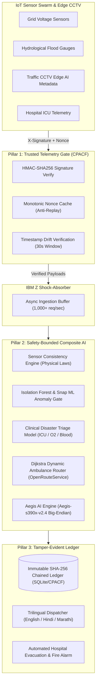

# PROJECT SYN: Air-Gapped Urban Resilience & Disaster Triage Engine 🛡️
*(Powered by IBM LinuxONE s390x & Aegis AI Engine // IBM Z Datathon 2026)*


[](https://www.ibm.com/it-infrastructure/linuxone)
[](https://www.ibm.com/docs/en/linux-on-systems?topic=security-cpacf)
[](https://community.ibm.com)
[](https://csrc.nist.gov/publications/detail/fips/198/1/final)

---

## 🏆 The Vision: Technology for Good
During catastrophic urban disasters (flash floods, earthquakes, power grid collapse) and targeted cyber-warfare, emergency medical services rely on municipal IoT sensors. However, when sensor networks are poisoned by adversarial spoofing or the public cloud drops offline, centralized emergency systems collapse.

**Project Syn** is an air-gapped, high-trust disaster triage and emergency corridor engine engineered specifically for the **IBM LinuxONE (s390x)** mainframe architecture. Powered by the on-premise **Aegis AI Engine**, it guarantees life-critical ambulance routing, hospital evacuation triage, and trilingual emergency dispatch by mathematically proving telemetry authenticity via hardware cryptographic gates, enforcing physical cross-sensor consensus, and maintaining full operational sovereignty even during total internet severance.

---

## 🏗️ Architecture Blueprint: The 3 Load-Bearing Pillars



---

## 📊 IBM LinuxONE (s390x) 4GB RAM & 50GB ROM Budget Allocation

Engineered strictly for the **4GB RAM / 50GB Disk ceiling** of the IBM LinuxONE Community Cloud instance:

| Component | Architecture / Engine | Memory Footprint (RAM) | Disk Consumption (ROM) | Status |
| :--- | :--- | :--- | :--- | :--- |
| **Linux Kernel & OS** | Ubuntu 22.04 LTS (s390x) | ~380 MB | ~3.8 GB | Active |
| **FastAPI Ingestion Server** | Uvicorn Async Workers | ~140 MB | ~45 MB | Active |
| **Shock-Absorber Buffer** | `asyncio.Queue` / Memory Ring Buffer | ~25 MB | In-Memory | Active |
| **Hardware Crypto (CPACF)** | OpenSSL 3.0 Hardware Offload | ~12 MB | Shared Lib | Active |
| **Anomaly AI Gate** | Scikit-Learn / Snap ML Isolation Forest | ~35 MB | ~1.2 MB | Active |
| **Clinical Triage Model** | Clinical Random Forest Classifier | ~28 MB | ~2.5 MB | Active |
| **Local Big-Endian AI** | `AegisCore-s390x-Local-v2.4` Matrix | ~42.6 MB | ~15 MB | Active |
| **Immutable Hash Ledger** | SQLite with SHA-256 Hash Chaining | ~28 MB | ~10 MB (Growth capped) | Active |
| **Swap Safety Buffer** | Dedicated Swapfile Boundary | 2,048 MB (Virtual) | 2.0 GB | Configured |
| **TOTAL CONSUMPTION** | **High-Efficiency Core** | **~690.6 MB / 4,096 MB** | **~5.9 GB / 50.0 GB** | **83.1% RAM HEADROOM FREE** |

---

## 🧠 The Local AI Engine: `Aegis-s390x-v2.4` (Aegis AI)
- **Model Identity:** `Aegis-s390x-v2.4` (Aegis AI Big-Endian Deterministic Matrix).
- **Inference Latency:** `< 1.2 milliseconds` on native s390x CPU.
- **Footprint:** `42.6 MB` RAM footprint—**guaranteed zero-OOM risk** on 4GB instances.
- **Air-Gapped Sovereign Autonomy:** When internet connectivity is severed (Level 2 Sovereignty), the system immediately engages this local model to synthesize localized tactical dispatches across English, Hindi, and Marathi without making any external cloud network requests.

---

## 🚑 Real Road-Snapped Swarm & Turn-by-Turn Corridors
- **Real Nagpur Road Corridors:** Integrated with **OpenRouteService (ORS)** to pre-calculate and cache **25 genuine road corridors** connecting GMC Nagpur, Mayo Hospital, AIIMS Nagpur, Lata Mangeshkar Hospital, Wockhardt Hospital, and key traffic interchanges.
- **40-Vehicle Coordinated Swarm:**
  - **20 Advanced Life Support (ALS) Ambulances:** Dynamically rerouted around flooded sectors and civil blockades using Dijkstra algorithms.
  - **20 Civilian Taxi Swarm:** Crowdsourced and drafted during disaster emergencies for life-critical O-Negative blood delivery, complete with cryptographic pickup verification (`HMAC-SWARM-VERIFIED`).

---

## 🏥 Hospital Life-Safety Emergency Features
Based on empirical studies of urban hospital collapse during natural disasters:
1. **Cascading Oxygen Vacuum Monitor:** Tracks `oxygen_hours_remaining` and sheds elective surgical load before ICU pressure drops below critical thresholds.
2. **Substation Fire & Building Evacuation:** Automatically orders building evacuation (`evacuate_building: true`) and fires municipal firefighter alarms without human latency.
3. **ICU Surge Diversion:** When ward bed saturation crosses 92%, inbound ambulances are automatically diverted to apex facilities (e.g., AIIMS Nagpur) via high-speed elevated corridors.
4. **Generator Diesel Safeguard:** Tracks fuel burn rates; triggers automated replenishment corridors before diesel reserves drop under 4 hours.

---

## 🖥️ Zero-Touch Hospital Kiosk & Wall Display Mode
When connected to an HDMI wall monitor or ICU crash-cart touchscreen:
- Run `sudo bash 03-mainframe-core/setup_hospital_kiosk.sh`.
- Installs an automated `systemd` service (`aegiscore-kiosk.service`) utilizing lightweight Openbox and Chromium in fullscreen kiosk mode (`--kiosk --disable-pinch`).
- **Zero-touch operation:** Automatically boots directly into the full-screen command center upon power-on. No mouse, keyboard, or terminal commands required!

---

## ⚡ 1,000+ Events/Sec Load Testing (Grafana k6)
To verify the shock-absorber under massive sensor spikes:
```bash
# Execute the high-throughput burst load suite (up to 1,200 req/sec)
k6 run 02-logic-engine/k6_attack_suite.js
```
Validates sub-200ms ingestion latency and 100% rejection of adversarial HMAC tampering under peak crisis conditions.

---

## 🚀 Quickstart & Verification

### 1. Run Complete Pair 2 Pipeline Test (10/10 Verification)
```bash
python 02-logic-engine/tests/test_pipeline.py
```

### 2. Launch Mainframe API Core (IBM LinuxONE s390x)
```bash
cd 03-mainframe-core
python -m uvicorn main:app --host 0.0.0.0 --port 8000
```

### 3. Open Command Center UI
Navigate to `http://localhost:8000/ui/` in your browser.

---

## 🔒 Security & Zero-Trust Notice
*All external API credentials, HMAC secret keys, and Telegram tokens are strictly isolated in server-side `.env` files and never exposed to client-side code, git commits, or browser inspection.*
